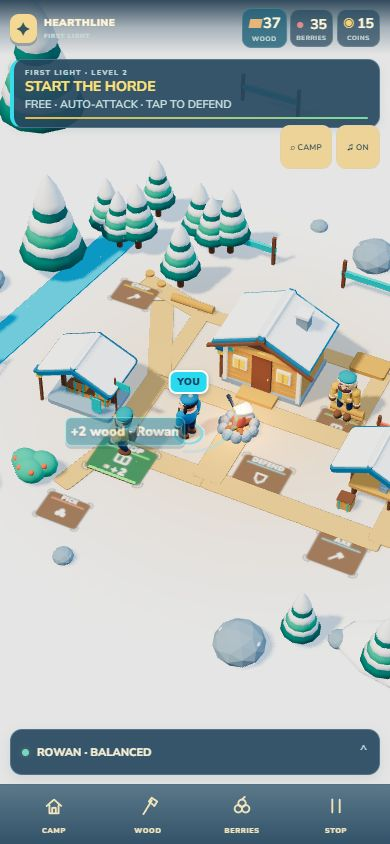

# Hearthline 3D

A playable, portrait-first strategy game about rebuilding a snowy frontier. Gather wood and berries, repair the hearth, recruit workers, automate production, defend the camp, and open the wider map through paid improvements and repeatable jobs. Progress saves in the browser.



## Play locally

Serve this directory over HTTP, then open `http://localhost:8767/`:

```sh
npx --yes http-server . -p 8767 -c-1
```

Requires Node.js for the command above. Alternatively use `python -m http.server 8767` if Python is installed. The game has no build step. Three.js 0.186.0 and the required loaders are bundled under `vendor/three/` so the game loads without a third-party script CDN. A network connection is only used for the optional Google font; system fonts are the fallback.

## Controls and progression

- Tap the objective to follow the next step, or use **Wood**, **Berries**, **Stone**, and **Camp** in the bottom bar.
- Tap open ground or use WASD/arrow keys to move. Drag on the left side on touch devices.
- Combat attacks automatically when a target is in range. Move into range, equip a weapon, and protect the hearth or convoy.
- Recruit Rowan, automate gathering and shipments, finish the Watch Lodge, and expand into Stone Ridge. The market adds physical goods, customers, and collected coins to the later economy.
- Sound is opt-in. The camp overview and reduced-motion setting are supported.

## Checks

`npm run check` runs the deterministic game, save, economy, route, combat, expansion, and market checks. The source can also be checked with `node --check src/*.js` (or the equivalent loop on Windows). The current source passed those checks and a local browser opening/progression smoke test.

## Scope

This is a finite playable frontier build, with local browser saves and no account or cloud sync. Desktop browser loading and the opening flow have been verified. Physical phone performance, touch comfort, and speaker mix still need device testing before a mobile release.

Three.js is distributed under the [MIT license](vendor/three/LICENSE).

Storage access denied by browser privacy settings no longer prevents startup. The camp remains playable for the open tab and reports that saving failed; persistence cannot be guaranteed while storage is blocked. Regression checks cover a throwing storage getter and failed writes.
